# Warehouse architecture

```mermaid
flowchart LR
  A[Complete CRM and ERP CSV snapshot] --> B[Python runner and preflight]
  S[Task Scheduler or manual command] --> B
  B -->|Linux only| C[Hash-audited UTF-16 sidecars]
  B --> D[etl.load_warehouse]
  C --> D
  D --> E[Verify source and sidecar hashes]
  E --> F[BULK INSERT into temporary staging]
  F -->|All six files and row counts match| G[Bronze append-only batches]
  G --> H[Silver safe conversions, upserts, rejects]
  H --> I[Gold SCD2 dimensions and date dimension]
  I --> J[Materialized fact snapshot]
  J --> K[Reconciliation and quality gates]
  K --> L{Critical checks pass?}
  L -->|Yes| M[Commit Gold and mark run successful]
  L -->|No| N[Rollback Gold and persist failed run]
  M --> O[05_analytics SQL reports]
  M --> P[Run, table, quality, rejection, and reconciliation audit]
  N --> P
```

The Python command validates the six complete CSV snapshots before connecting. On Linux, it creates UTF-16 sidecars because the SQL Server bulk interface does not accept a UTF-8 code page option there. SQL Server checks the original and sidecar hashes, then reads each sidecar into temporary tables. The Bronze transaction begins only after all six file imports and row-count checks succeed. Distinct content hashes are retained once; replayed files map to their original Bronze batch.

Silver contains the latest accepted snapshot. `FULL` clears and reloads the current Silver snapshot in one transaction. `INCREMENTAL` compares row hashes and applies inserts, updates, and deletes against the provided complete snapshots. Since the inputs are full snapshots, deletes are safe to reconcile. Neither mode deletes Bronze history or resets Gold surrogate keys.

Gold dimensions are persisted tables. Changed customer/product attributes expire the previous row and add a new current SCD Type 2 row. Source files do not contain reliable attribute-change timestamps, so the version effective time is the warehouse observation timestamp. Facts in this latest-snapshot warehouse resolve to the current dimension row observed in the same run; the project does not claim event-time historical attribution.

Gold changes and quality checks share a transaction. A critical failure rolls back the dimensions, date dimension, and facts as a unit. Bronze and Silver work plus the pipeline run record remain auditable. Test results are preserved from the failed Gold transaction using a sanitized session payload.

## Failure boundaries

- Local preflight failures produce a failed pipeline record when SQL Server is reachable.
- SQL Server bulk-load errors occur before persistent Bronze changes. The error summary records a SQL error number and stage, not source values.
- Silver transformation errors roll back the Silver snapshot transaction.
- Critical Gold quality failures roll back Gold publication; warnings remain visible but allow the run to finish.
- `etl.pipeline_runs`, `etl.table_load_logs`, `etl.data_quality_results`, `etl.rejected_records`, and `etl.reconciliation_results` provide the persistent audit trail.

The dependency graph and transaction boundaries are also available in [pipeline_dependencies.md](pipeline_dependencies.md). Column-level examples from source through Bronze and Silver to Gold are in [column_lineage.md](column_lineage.md).
