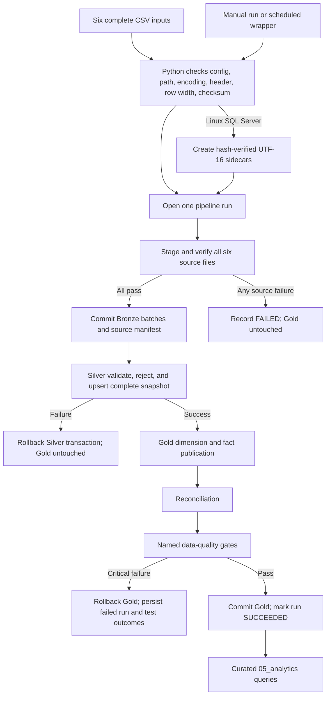

# Pipeline dependencies and failure boundaries

## Dependency graph

## Stage contracts

| Stage | Reads | Writes | Transaction / publication rule |
| --- | --- | --- | --- |
| Python preflight | `etl.source_config`, six configured files | A manifest in memory; Linux sidecars for the run | No warehouse rows are changed. When SQL Server is reachable, preflight failures are recorded. |
| Bronze | Validated manifest, original files, optional sidecars | Append-only Bronze batches, `etl.source_file_history`, `etl.pipeline_source_files`, per-table logs | Hashes and row counts are verified for all six files before the Bronze transaction commits. A repeated checksum reuses its original batch. |
| Silver | Bronze batches registered for this run | Current CRM/ERP Silver snapshot and reason-coded rejects | The complete snapshot is transformed in a transaction. Invalid rows are excluded with hashed fingerprints and reason codes. |
| Gold | Accepted Silver snapshot | Stable SCD2 dimensions, dense date dimension, fact snapshot | Gold load, reconciliation, and quality gates run in one transaction. Critical failures roll back publication. |
| Analytics | Committed Gold dimensions and facts | Query result sets only | Scripts are read-only and define their grain and metric calculations in comments. |

Run-level state is in `etl.pipeline_runs`; stage and per-table state is in `etl.table_load_logs`. Source content is never copied into failure summaries or rejection logs. Gold results are available only after the critical gates pass.
