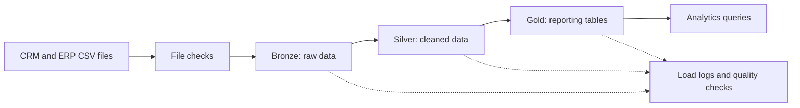

# SQL Data Warehouse and Analytics Project

[](https://github.com/Friday-code254/SQL-Data-Warehouse/actions/workflows/warehouse-ci.yml)


This project combines customer, product, and sales data from CRM and ERP CSV files in a SQL Server data warehouse. It checks the files, loads and cleans the data, and prepares it for reporting.

## What the project does

- Checks all six input files before loading them.
- Keeps a record of each source file and load, so rerunning the same files does not add duplicate Bronze data.
- Cleans and validates records. Rejected rows are saved with a reason code for review.
- Builds customer, product, date, and sales tables for analysis.
- Keeps a history of customer and product changes with SCD Type 2.
- Checks row counts and sales amounts as data moves through the warehouse.
- Includes automated tests, GitHub Actions CI, and six analytics queries.

## How the data moves



- **Bronze** keeps the source rows and file details.
- **Silver** converts and checks the data. Rows that fail a rule are logged with a reason.
- **Gold** contains the sales fact table and customer, product, and date dimensions.

## Source files

| File | Data |
|---|---|
| `source_crm/cust_info.csv` | Customer details |
| `source_crm/prd_info.csv` | Products and product dates |
| `source_crm/sales_details.csv` | Sales, quantities, prices, and dates |
| `source_erp/CUST_AZ12.csv` | Customer birth date and gender |
| `source_erp/LOC_A101.csv` | Customer country |
| `source_erp/PX_CAT_G1V2.csv` | Product categories and subcategories |

## Data quality in the supplied files

The figures below are from the sample data included in this project. See the [data quality report](06_reports/sample_data_quality_profile.md) for more detail.

| Sales results | Rows | Amount |
|---|---:|---:|
| Source sales | 60,398 | 29,355,647 |
| Accepted in Gold | 60,360 | 29,347,942 |
| Rejected sales | 38 | 7,705 |

The 38 rejected sales rows have these reasons:

| Reason | Rows | Amount |
|---|---:|---:|
| Invalid order date | 19 | 4,922 |
| Negative sales or price | 7 | 2,471 |
| Sales do not match quantity × price | 12 | 312 |

The rejected amounts explain the full **7,705** difference between source and Gold. There is no unexplained amount left. This balance does not mean the rules are business-approved. A data owner should decide whether these rows should be corrected, kept as exceptions, or excluded from the approved sales total.

The sample run also recorded 26 rejected customer and customer-enrichment rows. It corrected 200 product end dates: 102 were rebuilt from the next product version and 98 were cleared for the latest versions. These product corrections are marked and reported as warnings.

## How to run

You need SQL Server 2022, SQLCMD, Python 3.9 or later, and Microsoft ODBC Driver 18 for SQL Server. SQL Server must be able to read the six CSV files. Its file path can be different from the path on your computer.

Run commands from the project folder.

### 1. Install the database objects

For Windows authentication:

```powershell
sqlcmd -S localhost -E -b -i 00_setup/install.sql
```

For SQL authentication, SQLCMD will prompt for your password:

```powershell
sqlcmd -S <server> -U <user> -C -b -i 00_setup/install.sql
```

The installer can be run again and does not clear existing warehouse data.

### 2. Set up Python

```powershell
Copy-Item .env.example .env
python -m pip install -r requirements.txt
```

Edit `.env` with your SQL Server connection details. The `.env` file is ignored by Git, so credentials should stay there and must not be committed. Set `SQLSERVER_DATASET_ROOT` if SQL Server sees the CSV files in a different location. See [`.env.example`](.env.example) for the available settings.

### 3. Run the pipeline

Use a full load for the first run:

```powershell
python 03_scripts/etl/run_pipeline.py --mode full
```

For later complete snapshots, use:

```powershell
python 03_scripts/etl/run_pipeline.py --mode incremental
```

Both modes need all six files. A full load rebuilds the current Silver data and refreshes Gold. An incremental load applies new, changed, and removed rows from the new complete snapshot. Bronze history is kept.

> `00_setup/development_reset.sql` drops the database. Use it only for a disposable development database.

## Checks and analytics

Run the Python unit tests with:

```powershell
python -m unittest discover -s 04_tests/unit -v
```

For SQL Server integration tests, use a disposable development database. These tests change data:

```powershell
$env:RUN_SQL_INTEGRATION = "1"
python -m unittest discover -s 04_tests/integration -p "test_*.py" -v
```

After a successful load, run the smoke check:

```powershell
sqlcmd -S localhost -E -b -d DataWarehouse -i 04_tests/smoke_test.sql
```

The GitHub Actions workflow runs the project checks against a temporary SQL Server database. It also checks replay, failure handling, redeployment, SCD Type 2 changes, and all analytics queries. See [the workflow](.github/workflows/warehouse-ci.yml).

The six Gold queries cover:

- Monthly sales and month-over-month changes
- Product and category performance
- Customer lifetime sales
- Sales by country and customer segment
- Order value and quantity
- Order and shipping trends

Run a query from the project folder, for example:

```powershell
sqlcmd -S localhost -E -b -d DataWarehouse -i 05_analytics/monthly_sales_mom.sql
```

The [performance report](06_reports/performance_report.md) records benchmark timings and logical reads. Those results are from one SQL Server environment and may differ elsewhere.

## Project folders

| Folder | Contents |
|---|---|
| `00_setup/` | Database installer, development reset, and Docker helper |
| `01_datasets/` | CRM and ERP CSV files |
| `02_docs/` | Architecture, source mapping, and design notes |
| `03_scripts/` | SQL tables, ETL procedures, and quality checks |
| `04_tests/` | Python tests, SQL Server checks, and benchmarks |
| `05_analytics/` | Gold analytics queries |
| `06_reports/` | Data quality and performance reports |
| `07_orchestration/` | Windows scheduling scripts and instructions |

The source files, diagrams, starter SQL, and original documentation come from the [Data With Baraa SQL Data Warehouse project](https://github.com/DataWithBaraa/sql-data-warehouse-project). This project keeps its original MIT license and attribution. See [`LICENSE`](LICENSE).
