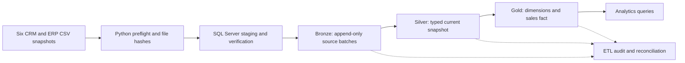

# SQL Server Data Warehouse

[](https://github.com/Friday-code254/SQL-Data-Warehouse/actions/workflows/warehouse-ci.yml)


[](LICENSE)

An end-to-end SQL Server warehouse for CRM and ERP sales data. The project turns six CSV snapshots into validated, auditable Bronze batches, a clean Silver snapshot, and a dimensional Gold model for business analysis. It includes a Python preflight runner, SQL Server ETL, data-quality gates, reconciliations, acceptance tests, performance benchmarks, and six ready-to-run analytics queries.

> **Data-quality note:** the supplied sales snapshot has 60,398 source lines and 60,360 accepted Gold facts. The remaining 38 lines are preserved in the reject ledger with reason codes and source amounts. Their total of 7,705 fully explains the source-to-Gold amount difference for this snapshot. That accounting reconciliation does **not** approve the underlying business rules; review the rejected rows with a data owner before treating the Gold totals as business-approved.

## Contents

- [Project overview](#project-overview)
- [Architecture](#architecture)
- [Warehouse layers](#warehouse-layers)
- [Data quality and sample results](#data-quality-and-sample-results)
- [Quick start](#quick-start)
- [Configure and run the pipeline](#configure-and-run-the-pipeline)
- [Validate the project](#validate-the-project)
- [Analytics](#analytics)
- [Performance](#performance)
- [Operations and troubleshooting](#operations-and-troubleshooting)
- [Repository map](#repository-map)
- [Limitations and design notes](#limitations-and-design-notes)
- [Attribution and license](#attribution-and-license)

## Project overview

| | |
|---|---|
| **Platform** | SQL Server 2022, T-SQL, Python, ODBC Driver 18 |
| **Architecture** | Bronze → Silver → Gold; snapshot-based ETL |
| **Warehouse model** | Sales fact with customer, product, and role-playing date dimensions |
| **Source data** | Three CRM and three ERP CSV files in `01_datasets/` |
| **Automation** | Command-line runner, Windows Task Scheduler wrapper, GitHub Actions |
| **Quality controls** | File preflight, SHA-256 verification, reject ledger, data-quality gates, reconciliations |

The goal is to demonstrate the practical engineering around a warehouse—not only its final reporting tables. A run is traceable from input file fingerprints through row counts, transformations, rejected records, quality results, and the published Gold facts. A failed critical check rolls back Gold publication and leaves the prior successful Gold state available.

### Source files

| System | File | Contents |
|---|---|---|
| CRM | `source_crm/cust_info.csv` | Customer identifiers and core profile attributes |
| CRM | `source_crm/prd_info.csv` | Products, product versions, and validity dates |
| CRM | `source_crm/sales_details.csv` | Sales transaction lines, dates, quantities, prices, and amounts |
| ERP | `source_erp/CUST_AZ12.csv` | Customer birth date and gender enrichment |
| ERP | `source_erp/LOC_A101.csv` | Customer country/location enrichment |
| ERP | `source_erp/PX_CAT_G1V2.csv` | Product category, subcategory, and maintenance attributes |

## Architecture



The runner validates file presence, UTF-8 CSV structure, exact headers, field counts, row counts, line endings, file size, and SHA-256 before opening a pipeline run. SQL Server verifies file checksums again and stages all six inputs before writing Bronze data. On Linux, the runner creates checksum-verified UTF-16 sidecars for SQL Server bulk loading; the sidecars are removed after the run.

Bronze batches are append-only and keyed by source content. Replaying unchanged files reuses their existing batches instead of duplicating raw rows. Silver and Gold are committed at their documented transaction boundaries. The ETL control tables retain run status, per-table counts, quality outcomes, rejection reasons, file history, reconciliation values, and failure summaries.

## Warehouse layers

| Layer | Purpose | Key behavior |
|---|---|---|
| **Bronze** | Preserve source snapshots and load metadata | Raw values, batch identifiers, file names, content hashes, load timestamps, row fingerprints |
| **Silver** | Produce typed and validated current-state tables | Safe conversions, deduplication, row-hash upserts, snapshot delete reconciliation, reason-coded rejects, explicit correction codes |
| **Gold** | Serve analytics from a constrained dimensional model | Materialized `gold.fact_sales`, SCD Type 2 customer and product dimensions, `gold.dim_date`, stable surrogate keys, foreign keys, workload-aligned indexes |
| **ETL control plane** | Explain and monitor each run | `etl.pipeline_runs`, `etl.table_load_logs`, `etl.source_file_history`, `etl.rejected_records`, `etl.data_quality_results`, `etl.reconciliation_results` |

The sales fact grain is one source sales line. `gold.fact_sales` joins to customer, product, and order/shipping/due date keys. Customer and product attribute changes create a new dimension version and expire the previous current version. Because the CSV sources do not provide reliable attribute-change timestamps, SCD Type 2 effective times represent when the warehouse observed the change; this project does not claim event-time historical attribution.

## Data quality and sample results

The profile below is measured from the CSV snapshot shipped with this repository and documented in [`06_reports/sample_data_quality_profile.md`](06_reports/sample_data_quality_profile.md). It is evidence about this snapshot and these validation rules, not an assertion that the rules are the business-approved policy.

| Sales reconciliation | Rows | Amount |
|---|---:|---:|
| Source sales lines / amount | 60,398 | 29,355,647 |
| Accepted Silver and Gold sales | 60,360 | 29,347,942 |
| `INVALID_DATE_OR_AMOUNT` rejects | 19 | 4,922 |
| `NEGATIVE_AMOUNT` rejects | 7 | 2,471 |
| `SALES_PRICE_MISMATCH` rejects | 12 | 312 |
| **Total rejected sales** | **38** | **7,705** |

For this run, the source-to-Gold bridge is:

```text
29,355,647 source amount
= 29,347,942 Gold amount
  + 4,922 invalid-date/amount rejects
  + 2,471 negative-amount rejects
  +   312 sales/price mismatch rejects
  +     0 accepted-source-to-Silver adjustment
  +     0 Silver-to-Gold difference
```

The pipeline records each reject amount and checks that the bridge residual is zero. The rejected records remain visible for investigation. In addition to the 38 sales rejects, the sample run recorded 10 CRM customer rejects and 16 ERP customer-enrichment rejects, for 64 reject-ledger entries in total. Silver also corrected 200 product end dates: 102 were rebuilt from the next product version's start date and 98 were cleared for latest versions. These product repairs are warnings and carry correction codes; they are not sales rejects.

See the [sample data quality profile](06_reports/sample_data_quality_profile.md) for the individual rule findings and review guidance. No data-quality rule should be changed solely to make the source and Gold row counts match.

## Quick start

### Requirements

- SQL Server 2022 recommended; SQL Server 2017 or later is required by the bulk-load syntax.
- SQLCMD utilities and Microsoft ODBC Driver 18 for SQL Server.
- Python 3.9 or newer.
- A SQL Server login with the documented database/schema/procedure and bulk-load permissions.
- The SQL Server service or container must be able to read all six source files. The path visible to SQL Server may differ from the path visible to Python.

For Linux ODBC installation, use Microsoft's [ODBC Driver instructions](https://learn.microsoft.com/sql/connect/odbc/linux-mac/installing-the-microsoft-odbc-driver-for-sql-server). SQL Server on Linux before 2022 CU24 may require `sysadmin` for bulk loading; use a current supported cumulative update and the least privilege supported by that release.

### Install the warehouse

Run these commands from the repository root. On Windows PowerShell, use:

```powershell
sqlcmd -S localhost -E -b -i 00_setup/install.sql
```

For SQL authentication, SQLCMD prompts for the password:

```powershell
sqlcmd -S <server> -U <user> -C -b -i 00_setup/install.sql
```

The installer creates `DataWarehouse` if needed, preserves existing tutorial tables as `*_legacy`, and is safe to run again. It does not clear warehouse data.

### Prepare Python

**Windows PowerShell**

```powershell
Copy-Item .env.example .env
py -m venv .venv
.\.venv\Scripts\Activate.ps1
python -m pip install -r requirements.txt
```

**macOS or Linux**

```bash
cp .env.example .env
python3 -m venv .venv
source .venv/bin/activate
python -m pip install -r requirements.txt
```

Edit `.env` with the connection settings for your local SQL Server. The file is ignored by Git; keep credentials in `.env` or environment variables and never commit them. `.env.example` documents the supported settings.

## Configure and run the pipeline

Start with a complete six-file snapshot:

```powershell
python 03_scripts/etl/run_pipeline.py --mode full
```

For subsequent complete snapshots, use:

```powershell
python 03_scripts/etl/run_pipeline.py --mode incremental
```

Both modes require all six configured source files. `full` transactionally rebuilds the current Silver snapshot and refreshes Gold while retaining Bronze batches and Gold surrogate-key history. `incremental` applies row-hash inserts/updates and reconciles rows missing from the complete new snapshot. Identical source files can be replayed without duplicating Bronze rows.

Important configuration settings in `.env`:

| Setting | Purpose |
|---|---|
| `SQLSERVER_SERVER` | SQL Server host and optional port/instance |
| `SQLSERVER_DATABASE` | Warehouse database; defaults to `DataWarehouse` |
| `SQLSERVER_DRIVER` | Installed ODBC driver name; defaults to ODBC Driver 18 |
| `SQLSERVER_TRUSTED_CONNECTION` | Use Windows integrated authentication when enabled |
| `SQLSERVER_USER`, `SQLSERVER_PASSWORD` | SQL authentication when trusted connection is disabled |
| `SQLSERVER_ENCRYPT`, `SQLSERVER_TRUST_CERTIFICATE` | ODBC encryption and local certificate behavior |
| `SQLSERVER_DATASET_ROOT` | Optional source directory as seen by the SQL Server service/container |

The six relative source paths, expected headers, and field counts are stored in `etl.source_config`. Change that configuration when a source schema or location changes so that preflight and SQL loading use the same contract. Input files must use consistent LF or CRLF endings and end with a line terminator.

### Docker on macOS

`00_setup/mac-docker/start.command` starts the SQL Server 2022 container and mounts the data directory read-only. It prompts for an `sa` password if `MSSQL_SA_PASSWORD` is unset. Configure SQL authentication and set `SQLSERVER_DATASET_ROOT=/sql/dwh_project/01_datasets` in `.env`, then install the schema and run the Python pipeline from the repository root. See [orchestration notes](07_orchestration/README.md) for scheduling guidance.

> **Reset warning:** `00_setup/development_reset.sql` drops the warehouse database. Use it only for a disposable development database. The normal installer and `full` pipeline mode preserve Bronze history and surrogate-key continuity.

## Validate the project

### Python preflight tests

```powershell
python -m unittest discover -s 04_tests/unit -v
```

### SQL Server acceptance tests

Integration tests change data in the configured database. Run them only against a disposable development database after installing the schema and loading a complete snapshot.

```powershell
$env:RUN_SQL_INTEGRATION = "1"
python -m unittest discover -s 04_tests/integration -p "test_*.py" -v
```

Additional SQL Server acceptance scripts in `04_tests/integration/` cover data-preserving redeployment, stable surrogate keys, SCD Type 2 changes, and invalid data. The test guide describes their expected results.

### Smoke check and analytics smoke run

```powershell
sqlcmd -S localhost -E -b -d DataWarehouse -i 04_tests/smoke_test.sql
```

Run one analytics query as described in the next section. GitHub Actions runs the project validator, SQL lint, Python unit suite, a disposable SQL Server 2022 instance, a full load, smoke checks, acceptance scenarios, replay/failure-isolation checks, and all six analytics scripts.

The workflow is defined in [`.github/workflows/warehouse-ci.yml`](.github/workflows/warehouse-ci.yml). Its SQL Server password is generated for the job; the workflow does not require repository secrets.

## Analytics

Each SQL script in `05_analytics/` runs against the Gold schema and documents its business question, metric definition, and interpretation notes.

| Script | Analysis |
|---|---|
| [`monthly_sales_mom.sql`](05_analytics/monthly_sales_mom.sql) | Monthly sales, units, and month-over-month change |
| [`product_performance.sql`](05_analytics/product_performance.sql) | Product and category sales contribution |
| [`customer_lifetime_value.sql`](05_analytics/customer_lifetime_value.sql) | Customer order frequency and lifetime sales |
| [`country_customer_segments.sql`](05_analytics/country_customer_segments.sql) | Sales by country and customer segment |
| [`order_value_quantity.sql`](05_analytics/order_value_quantity.sql) | Monthly order count, average order value, and units per order |
| [`order_shipping_trends.sql`](05_analytics/order_shipping_trends.sql) | Order volume, fulfillment time, and late shipments |

Example:

```powershell
sqlcmd -S localhost -E -b -d DataWarehouse -i 05_analytics/monthly_sales_mom.sql
```

See [`05_analytics/README.md`](05_analytics/README.md) for all query notes. The analyses are descriptive and do not imply that a customer or product attribute caused a sales outcome.

## Performance

The benchmark in [`04_tests/performance/benchmark_gold.sql`](04_tests/performance/benchmark_gold.sql) compares representative Gold reporting workloads with the selected reporting indexes disabled and enabled. In the recorded SQL Server 2022 Linux run, logical reads changed as follows:

| Workload | Baseline reads | Indexed reads | Recorded change |
|---|---:|---:|---:|
| Monthly sales by order date | 1,173 | 305 | −74% |
| Product sales rollup | 1,173 | 305 | −74% |
| Customer sales rollup | 1,561 | 633 | −59% |

These are measurements from one local container and dataset, not a general performance guarantee. Elapsed times varied between repeated runs. The [performance report](06_reports/performance_report.md) records the methodology, query plans, logical reads, and timings; rerun it under controlled conditions before making claims for another environment.

## Operations and troubleshooting

After a run, inspect the `etl` audit tables for its status and detail:

| Table | What it records |
|---|---|
| `etl.pipeline_runs` | Run status, start/end time, mode, and sanitized failure summary |
| `etl.table_load_logs` | Per-table source, inserted, updated, deleted, rejected counts, and duration |
| `etl.source_file_history` | File fingerprints and checksum-based replay history |
| `etl.rejected_records` | Source identifier/fingerprint and reason code; raw source values are not copied |
| `etl.data_quality_results` | Named rule, severity, actual/expected values, and outcome |
| `etl.reconciliation_results` | Source-to-Bronze-to-Silver-to-Gold counts and sales amount bridges |

If preflight succeeds but `BULK INSERT` fails, verify that the path in `SQLSERVER_DATASET_ROOT` is valid **from the SQL Server host/container**, that all source files are mounted there, and that the SQL Server service account can read them. For a schema mismatch, compare the CSV header with `etl.source_config`. For a failed critical gate, review the latest `etl.data_quality_results` and `etl.rejected_records`; the previous successful Gold state is preserved.

On Windows, scheduled incremental runs can use `07_orchestration/run_pipeline.ps1 -Mode incremental`. Schedule it only after all six files for a complete source snapshot have arrived. The wrapper writes logs and preserves the Python process exit code. See [`07_orchestration/README.md`](07_orchestration/README.md).

## Repository map

| Path | Contents |
|---|---|
| `00_setup/` | Repeatable installer, development-only reset, and Docker helper |
| `01_datasets/` | Supplied CRM and ERP CSV snapshots |
| `02_docs/` | Architecture, data catalog, mappings, lineage, design decisions, and pipeline boundaries |
| `03_scripts/` | Database bootstrap, migrations, Bronze/Silver/Gold DDL and procedures, orchestration, reconciliation, and quality checks |
| `04_tests/` | Python unit tests, SQL Server acceptance tests, smoke check, and benchmark workload |
| `05_analytics/` | Six documented Gold analytics queries |
| `06_reports/` | Sample data-quality profile and reproducible performance report |
| `07_orchestration/` | Windows scheduling wrapper and scheduler guide |
| `.github/workflows/` | GitHub Actions CI workflow |

## Limitations and design notes

- The warehouse processes complete snapshots; this project does not implement CDC or partial-file ingestion.
- Gold facts reflect the latest accepted source snapshot. SCD Type 2 dimensions preserve observed attribute versions, but facts are resolved to the dimension versions current in the same warehouse run rather than inferred event-time versions.
- Several sample sales rows are rejected under the current rules. The zero-residual amount bridge proves where the 7,705 difference went; it does not establish whether those rows should be rejected, corrected, or modeled as credits/returns.
- Product end-date repairs and rejected-row counts should be reviewed whenever the source data or validation rules change.
- Performance results are environment-specific; benchmark your target SQL Server before making capacity or latency commitments.

Further design rationale is documented in [`02_docs/design_decisions.md`](02_docs/design_decisions.md), with source-to-column detail in [`02_docs/column_lineage.md`](02_docs/column_lineage.md).

## Attribution and license

The supplied source CSVs, diagrams, starter SQL, and documentation originate from the [Data With Baraa SQL Data Warehouse project](https://github.com/DataWithBaraa/sql-data-warehouse-project). This repository retains the original MIT license and attribution. The orchestration, safer ingestion, audit tables, Silver/Gold redesign, reconciliation, tests, analytics, and performance tooling are the project upgrades. See [`LICENSE`](LICENSE) for the license terms.
